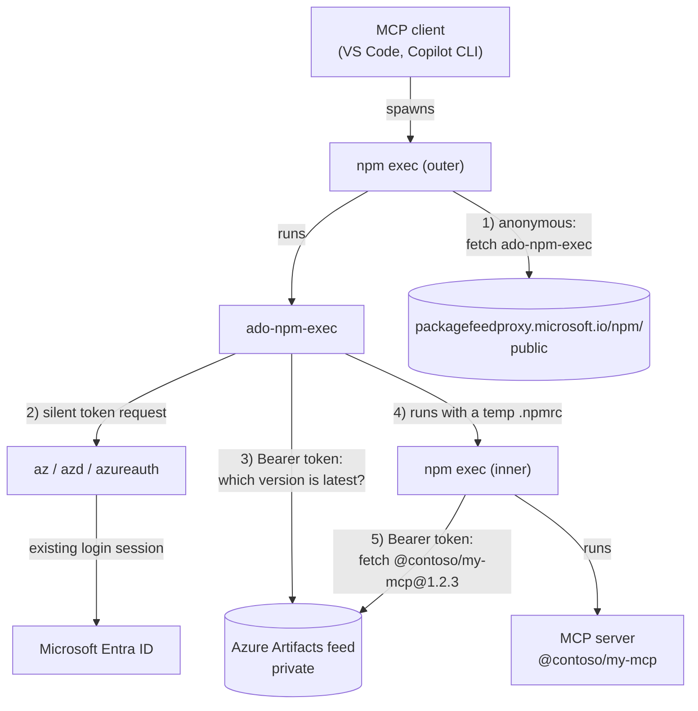
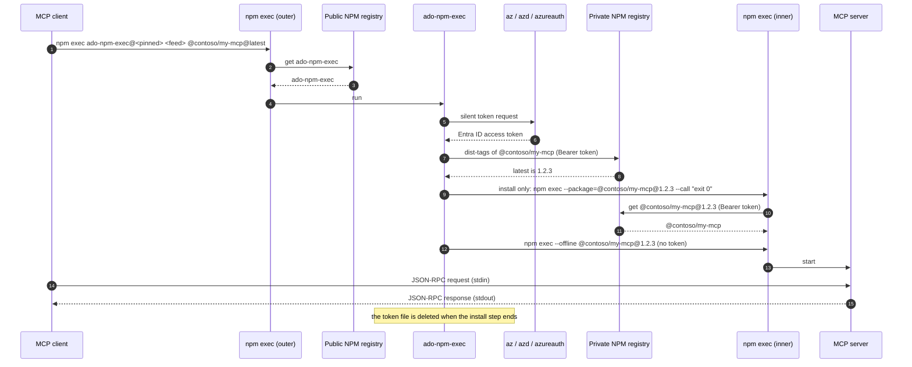
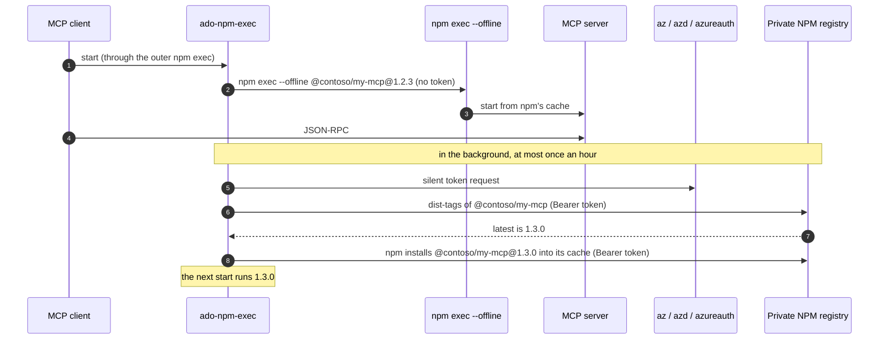

# ado-npm-exec

Run a package from a **private Azure DevOps (Azure Artifacts) npm feed** with
zero setup: no `.npmrc` edits, no PATs, no `vsts-npm-auth`. `ado-npm-exec` gets
a Microsoft Entra ID token silently from the Azure CLI (or the Azure Developer
CLI, or `azureauth`), resolves the package to an exact version on the feed,
hands the token to npm through a short-lived private config file to install
that version, and then starts it with `npm exec --offline`, without the token.
A package that ran before starts straight from npm's cache, with no token and
no network request; a newer version is installed in the background for the
next start.

It is built for **MCP stdio server configs** (VS Code, GitHub Copilot CLI and
other MCP clients), where stdout is the JSON-RPC channel and nothing may
prompt:

- never writes to stdout and never reads stdin (only `--login` lets the sign-in
  tool use the terminal); diagnostics go to stderr;
- zero runtime dependencies (it handles your Azure DevOps tokens, so its
  supply chain is just Node.js and npm);
- published from GitHub Actions with npm provenance.

## How it works

`ado-npm-exec` itself comes anonymously from the public npm proxy
`https://packagefeedproxy.microsoft.io/npm/`. Your
package comes from the private feed, with a Microsoft Entra ID token that is
only ever sent to that feed. The inner npm gets the feed as its default
registry and as the registry of the package's scope, so public dependencies
come through the feed's upstream sources; other scopes keep the `https`
registries your npm config gives them. (Azure Artifacts serves the package
files from its blob storage on another host, which gets no token.)



The first start of a package, step by step:



Every later start (see [Starts and updates](#starts-and-updates)):



## Requirements

- Node.js 20 or newer, with the npm that ships with it (npm 10 or 11).
- One signed-in token source: the [Azure CLI](https://learn.microsoft.com/cli/azure/install-azure-cli)
  (`az`), the [Azure Developer CLI](https://learn.microsoft.com/azure/developer/azure-developer-cli/install-azd)
  (`azd`), or `azureauth` with a cached account.
- Reader access to the Azure Artifacts feed.

## Quick start

1. Sign in once. In a terminal, let `ado-npm-exec` find the feed's tenant and
   sign you in to it:

   ```sh
   npm exec -y --prefix=~/ --registry=https://packagefeedproxy.microsoft.io/npm/ -- ado-npm-exec@2.0.0 \
     --login https://pkgs.dev.azure.com/<org>/_packaging/<feed>/npm/registry/
   ```

   It runs `az login --tenant <the feed's tenant> --allow-no-subscriptions`
   without az's subscription prompt (or `azd auth login` when only `azd` is
   installed), then checks that a token can now be acquired silently. The same
   by hand (PowerShell: `$env:AZURE_CORE_LOGIN_EXPERIENCE_V2='off'; az login ...`):

   ```sh
   AZURE_CORE_LOGIN_EXPERIENCE_V2=off az login --tenant <tenant> --allow-no-subscriptions
   ```

2. Add the server to your MCP config. Replace `<org>`, `<feed>` and the package
   spec, and **pin `ado-npm-exec` to an exact version** (see
   [Security model](#security-model)).

   **VS Code** (`.vscode/mcp.json` or the user-level `mcp.json`):

   ```json
   {
     "servers": {
       "my-mcp": {
         "type": "stdio",
         "command": "npm",
         "args": [
           "exec", "-y", "--prefix=~/", "--registry=https://packagefeedproxy.microsoft.io/npm/",
           "--", "ado-npm-exec@2.0.0",
           "--registry", "https://pkgs.dev.azure.com/<org>/_packaging/<feed>/npm/registry/",
           "--", "@contoso/my-mcp@latest", "--some-server-flag"
         ]
       }
     }
   }
   ```

   **GitHub Copilot CLI** (`~/.copilot/mcp-config.json`):

   ```json
   {
     "mcpServers": {
       "my-mcp": {
         "type": "local",
         "command": "npm",
         "args": [
           "exec", "-y", "--prefix=~/", "--registry=https://packagefeedproxy.microsoft.io/npm/",
           "--", "ado-npm-exec@2.0.0",
           "--registry", "https://pkgs.dev.azure.com/<org>/_packaging/<feed>/npm/registry/",
           "--", "@contoso/my-mcp@latest"
         ],
         "tools": ["*"]
       }
     }
   }
   ```

What the outer arguments do:

| Argument | Why |
| --- | --- |
| `exec -y` | Fetch and run `ado-npm-exec` without prompting. |
| `--prefix=~/` | Makes your home directory npm's project root for this one command. Without it, an `ado-npm-exec` copy in the workspace's `node_modules` could be run instead of the published package, and the workspace's `.npmrc` would apply. npm expands `~/` itself. |
| `--registry=https://packagefeedproxy.microsoft.io/npm/` | `ado-npm-exec` is a public npm package. This fetches it through Microsoft's public npm proxy, which needs no credentials and also works on managed devices where `registry.npmjs.org` is blocked. On other machines `--registry=https://registry.npmjs.org/` works too. |
| `ado-npm-exec@<exact version>` | Pinned. Never `@latest` for a tool that handles your tokens. New versions can take up to a week to reach the proxy, so pin a version that is at least a week old. |

Everything after `ado-npm-exec@…` is for `ado-npm-exec` itself: the feed URL,
then the package spec and the arguments for that package.

## Usage

```text
ado-npm-exec [options] --registry <feed-url> [--] <package-spec> [args...]
ado-npm-exec [options] <feed-url> <package-spec> [args...]
ado-npm-exec --login [--tenant <guid>] <feed-url>
ado-npm-exec --prewarm [options] <feed-url> <package-spec> [<package-spec>...]
ado-npm-exec --doctor [options] [<feed-url> [<package-spec>]]
```

Options are only recognized **before** the feed URL / package spec; everything
after the package spec is passed to the package unchanged.

| Option | Description |
| --- | --- |
| `--registry <url>` | Azure Artifacts npm feed URL (see [accepted URLs](#accepted-feed-urls)). |
| `--tenant <guid>` | Entra ID tenant of the feed's organization. Default: the tenant remembered for the organization (for a week), else discovered from the feed. |
| `--always-fresh`, `--fresh` | Resolve the spec on the feed before every start (an exact version needs no lookup) and run the newest matching version now, instead of [starting from npm's cache](#starts-and-updates). |
| `--no-offline-fallback` | Exit with an error instead of running the copy in npm's cache when no token can be acquired, or the feed or npm fails (see [offline fallback](#starts-and-updates)). `--offline-fallback` turns it back on (the default; it overrides `ADO_NPM_EXEC_OFFLINE_FALLBACK=0`). |
| `--verbose` | Print diagnostics to stderr (tokens and URL credentials are always redacted). |
| `-h`, `--help` / `-v`, `--version` | Help / version, printed to stderr. |

| Action | Description |
| --- | --- |
| `--login` | Sign in once for the feed's tenant: `az login --tenant <tenant> --allow-no-subscriptions` without the subscription prompt, or `azd auth login --tenant-id <tenant>` when only `azd` is installed. Then it checks that the tool now gives a token silently, and remembers the tool for the next start. Needs a terminal. |
| `--prewarm` | Resolve the package spec(s) and install them into npm's cache without running them, so their next start needs no token and no network (images, dev containers, CI caches, before a flight). |
| `--doctor` | Print a diagnostic report to stderr: runtime, the npm settings the inner npm gets, every token source on its own (claims only, never a token), the feed's answers, the download path, and what npm's cache holds for the package. Exit code 1 when it finds errors. |

| Environment variable | Description |
| --- | --- |
| `ADO_NPM_EXEC_TOKEN` | Use this Entra ID access token (a JWT for Azure DevOps) instead of az/azd/azureauth. PATs are rejected. |
| `ADO_NPM_EXEC_TENANT` | Same as `--tenant`. |
| `ADO_NPM_EXEC_ALWAYS_FRESH=1` | Same as `--always-fresh`. |
| `ADO_NPM_EXEC_OFFLINE_FALLBACK=0` | Same as `--no-offline-fallback`. |
| `ADO_NPM_EXEC_VERBOSE=1` | Same as `--verbose`. |
| `ADO_NPM_EXEC_TIMEOUT_MS` | Timeout for each run of a sign-in tool, 1000 to 120000 ms (default 10000). |
| `ADO_NPM_EXEC_SHELL` | The shell the sign-in notice writes its commands for: `pwsh` or `powershell`, `cmd`, or a POSIX shell such as `bash`. Default: from `SHELL`. |

`<package-spec>` must be a registry spec: `[@scope/]name[@version|range|tag]`.
URLs, paths, git specs and `npm:` aliases are refused because they would not
come from the feed.

Before npm runs, the spec is resolved to an exact version on the feed, the way
npm itself picks it: a dist-tag (`@latest`, `@next`) through the feed's small
dist-tags endpoint, a bare name or a range (`@^1.2`) through the package's
registry metadata, where deprecated versions, `engines` and npm's `tag`
setting (the default dist-tag) count like they do for npm. npm then runs
`<name>@<exact version>`. That matters because npm's exec cache folder is
keyed by the spec string: with `@latest`, every release was installed into
the same folder, under servers still running from it. When the version cannot
be picked exactly like npm (rare range syntax, npm's `before` setting), or the
feed cannot be asked directly (a proxy, see below), npm picks it: a dist-tag
with `npm view` (one request), anything else with
`npm install --package-lock-only` in a private temp folder (nothing is
downloaded or run). That exact version runs; the spec as written never does.
With npm's `before` setting, npm picks every version, an exact one too.

The version is installed into npm's exec cache first, with npm's output
captured, and only then started, from npm's cache: `npm exec --offline`
without the token. One process at a time installs a version: a start that
finds another process installing the same version waits for it (up to 5
minutes).

Exit codes: the package's own exit code when it runs; `2` usage or invalid
URL/spec; `3` no usable token, or the feed refused it (also when npm reports
`E401`/`E403` while installing); `4` npm not found; `5` the package, dist-tag
or version is not on the feed (also npm's `E404`/`ETARGET`); `1` refused to
run (no private temp directory, a file would shadow the package, the install
lock cannot be created, or an install in npm's cache that is incomplete or
from another registry cannot be replaced), the feed cannot be reached, another
install error, or an unexpected error. If npm is killed by a signal,
`ado-npm-exec` ends the same way (POSIX); a package killed by a signal usually
shows up as exit code 128 + signal number.

### Accepted feed URLs

Only `https` URLs of Azure Artifacts npm feeds are accepted:

```text
https://pkgs.dev.azure.com/<org>[/<project>]/_packaging/<feed>[@<view>]/npm/registry/
https://<org>.pkgs.visualstudio.com[/<project>]/_packaging/<feed>[@<view>]/npm/registry/
```

Anything else (other hosts, look-alike hosts, `http`, ports, credentials,
query strings, fragments, encoded characters other than `%20`, dot segments) is
rejected **before** a token is acquired.

## Starts and updates

For each feed and package spec, `ado-npm-exec` remembers the exact version the
spec resolved to (in `<npm cache>/_ado-npm-exec/`, next to npm's own cache; no
token is ever stored). When that version is completely installed in npm's exec
cache, downloaded from the feed's organization, and npm has the package's
registry metadata cached, the start is `npm exec --offline <name>@<version>`:
no token, no tenant discovery, no network request. An exact version
(`@contoso/my-mcp@1.2.3`) starts the same way without a record. Otherwise (the
first start, a cleaned npm cache, `--always-fresh`, npm's `before` setting),
`ado-npm-exec` gets a token, resolves the spec on the feed, installs that
version, and then starts it the same way.

- **Background updates.** After a start from npm's cache, when the feed was
  last asked more than an hour ago, `ado-npm-exec` asks it in the background
  (token, then the dist-tags or registry metadata). A newer version is
  installed into npm's exec cache without running it
  (`npm exec --package=<name>@<new version> --call "exit 0"`) and recorded for
  the **next** start; the running server is never replaced. The first check
  waits a random 0 to 10 seconds, so that servers started together do not run
  their sign-in tools at once. A session that runs for days asks again every
  6 hours (unless another session of the same spec just did), once the
  machine has run 5 minutes without sleeping (a laptop's short dark wakes are
  skipped). A feed that does not answer, or a missing sign-in, backs off from
  1 hour, doubling to a day. One line in the client's server log reports an
  installed update, a missing sign-in, or a spec the feed no longer has.
  Exact versions are never checked.
- **`--always-fresh`.** Resolves the spec on the feed before every start and
  runs the newest matching version now (the 1.x behavior, with the exact
  version). An exact version needs no lookup: a ready copy starts as it is.
  For developers who publish and want a new version at the next start.
- **Offline fallback.** When no token can be acquired, or the feed or npm
  fails for any other reason than a refused token or a missing package (the
  network, a proxy, an install that cannot finish), the copy in npm's cache
  starts instead, if there is one. `--no-offline-fallback` turns this off.
- **A failed start from the cache.** If a start from npm's cache exits with an
  error within 10 seconds (perhaps npm's cache was cleaned, or written by
  another npm version), the next start asks the feed and installs that
  version again. The old copy is moved aside first and put back if the new
  install fails (or by the next start, if the install was cut off), so a
  start without network still has it. If it cannot be moved aside, it is not
  replaced.
- **Removed from the feed.** When a background check's lookup finds that the
  feed has no version for the spec any more (the package, tag or version was
  removed), the next start asks the feed instead of starting the copy in
  npm's cache, and exits with code 5 if it is still gone. A newer version that
  npm cannot install (for example, a dependency the feed cannot serve yet)
  does not count: the copy in npm's cache keeps starting.
- **Cleanup.** Every version has its own folder in npm's exec cache
  (`<npm cache>/_npx/`). Folders `ado-npm-exec` installed are removed once no
  spec started or checked in the last 30 days uses them as its current or
  previous version, and no running session uses them: each session holds a
  lease on its version and refreshes it, because a server loads code lazily,
  long after it started. A lease on this machine counts while its processes
  run (also the npm that a killed `ado-npm-exec` started); one from another
  machine (a shared cache) while it is refreshed. A folder is removed under
  the same lock its install takes (a start takes it too while it claims the
  folder), after the leases were read again: it is renamed into
  `<npm cache>/_ado-npm-exec/trash/` and deleted from there. When a lease
  cannot be written or read, nothing is removed; a session that could not
  write its lease tries again every 30 seconds. Folders npm created for other
  `npm exec` runs are never touched.
- **Installs from another registry.** npm's exec cache folder is keyed by the
  spec string alone, so a manual `npx @contoso/tool@1.2.3` with another
  registry fills the same folder, and npm would run that copy. `ado-npm-exec`
  reads where npm downloaded the package from (the tarball URL in npm's hidden
  lockfile) and only uses an install from the feed's Azure DevOps
  organization. A start that asks the feed replaces any other install (and an
  interrupted one) with one from the feed; if another running process uses
  that folder, or it cannot be removed, the start is refused with exit code 1.
  An install also counts only with its command linked into the folder (an
  executable link; on Windows its `.cmd` shim): without the link, npm would
  look the command up on `PATH` and could run a workspace's
  `node_modules/.bin/<command>`.
- **Behind a proxy, or with certificate checks off.** Tenant discovery and
  version lookups use Node's fetch, which uses a proxy only with Node's own
  proxy support: `NODE_USE_ENV_PROXY=1` and `HTTPS_PROXY` (Node 22.21+ or
  24+). When a proxy is configured that fetch does not use, npm (which uses
  it) picks the version at once, and that exact version is installed and
  runs; pass `--tenant` too, or the start cannot find the feed's tenant until
  it remembers one. The same happens when `NODE_TLS_REJECT_UNAUTHORIZED=0`
  turns Node's certificate checks off: `ado-npm-exec` then never sends the
  token itself, only npm does, always with `--strict-ssl=true`. Better: give
  Node and npm your proxy's CA certificate (`NODE_EXTRA_CA_CERTS`, npm's
  `cafile`).

`--prewarm` does a background update's work in the foreground, for one or
more specs:

```sh
npm exec -y --prefix=~/ --registry=https://packagefeedproxy.microsoft.io/npm/ -- ado-npm-exec@2.0.0 --prewarm \
  https://pkgs.dev.azure.com/<org>/_packaging/<feed>/npm/registry/ @contoso/my-mcp@latest @contoso/other@^2
```

## Authentication

Only **Microsoft Entra ID access tokens** for the Azure DevOps resource
(`499b84ac-1321-427f-aa17-267ca6975798`) are used. Personal access tokens are
deliberately not supported.

1. **`ADO_NPM_EXEC_TOKEN`**, when set. It must be an Entra ID JWT; anything else
   fails the run: the tools are not tried instead.
2. Otherwise the tools, **one at a time**. The tool that gave the last token
   for the feed's tenant runs first, alone, so one sign-in is reused; the
   others run, in the order below, only when it has no token. That tool is
   remembered per tenant in `<npm cache>/_ado-npm-exec/sign-in.json` (its
   name only, never a token). Each run of a tool gets up to 10 seconds
   (`ADO_NPM_EXEC_TIMEOUT_MS`); az runs once more when it fails fast for
   another reason than a missing sign-in (servers that start together share
   its token cache).
   - **Azure CLI**: `az account get-access-token --resource 499b84ac-… --tenant <tenant>`.
     Uses your `az login` session (user, service principal or managed
     identity) and never prompts.
   - **Azure Developer CLI**: `azd auth token --output json --no-prompt --scope 499b84ac-…/.default --tenant-id <tenant>`,
     the same call `@azure/identity` makes. Uses your `azd auth login` session.
   - **azureauth**: `azureauth ado token --output headervalue --tenant <tenant>`,
     run with `AZUREAUTH_NO_USER=1` so it can only work silently (its cached
     account, plus Integrated Windows Auth on Windows). Its PAT sources
     (`AZUREAUTH_ADO_PAT`, `SYSTEM_ACCESSTOKEN`) are removed from its
     environment and a `Basic` (PAT) answer is rejected.

The tools run from a folder no workspace controls (`/bin`, or `%SystemRoot%`
on Windows), as `@azure/identity` does: an MCP client starts servers in an
arbitrary project, and `azd`, for one, reads project settings from its current
folder.

Each token is sanity-checked locally before use: audience must be Azure DevOps,
it must not expire within 2 minutes, and its tenant must match the feed's. A
token that fails a check counts as a failed tool. The signature is not checked
locally; Azure DevOps checks it.

**Tenant discovery.** An anonymous request to the feed returns `401` with the
organization's tenant (`x-vss-resourcetenant`, or the `authorization_uri` of
the `Bearer` challenge). That tenant is passed to the tools so you get a token
for the right directory even if your default tenant is another one. The
request carries no credentials and does not follow redirects. The tenant found
is remembered per organization for a week (in `<npm cache>/_ado-npm-exec/`),
so later starts skip the request; it is forgotten when the feed refuses the
token or the tools have none for it. Pass `--tenant` to skip it altogether
(for example behind a proxy Node's fetch does not use).

| | Azure CLI (`az`) | Azure Developer CLI (`azd`) | `azureauth ado token` |
| --- | --- | --- | --- |
| Returns | Entra ID token only | Entra ID token only | A PAT from env if present, else an Entra ID token (PAT paths are disabled by ado-npm-exec) |
| Session | `az login` | `azd auth login` | Its cached account (plus Integrated Windows Auth on Windows) |
| Silent | Always | With `--no-prompt` (passed) | Only with `AZUREAUTH_NO_USER=1` (set by ado-npm-exec) |
| Typical setup | `ado-npm-exec --login <feed>` | `azd auth login --tenant-id <tenant>` | Preinstalled on some developer machines |

When no tool has a token, the start prints a framed **Sign-in needed** notice
with the exact command for your shell, and exits with code 3 (unless the copy
in npm's cache can run instead). When the feed refuses the token, a
**Sign-in refused** notice names the account and asks for the Reader role.

## Security model

**Threat model.** An MCP config is already code execution: whoever writes it
chooses the command. What `ado-npm-exec` adds is a credential, so it must make
sure the token only ever reaches Azure DevOps, and that it runs what you asked
for from the feed you named.

- **Host allowlist.** The token is only used for an `https` Azure Artifacts feed
  on `pkgs.dev.azure.com` or `<org>.pkgs.visualstudio.com`. Those hosts are
  operated by Microsoft; an organization owner (even of an attacker-created
  organization) cannot read the credentials sent to them. A token issued for a
  different tenant is simply rejected by Azure DevOps. If you work with several
  tenants, pin `--tenant`. Version lookups send it to the feed's dist-tags
  endpoint and package metadata, over https, without following redirects.
- **Never in argv, and never for the server.** The token is written to a
  `.npmrc` inside a fresh `mkdtemp` directory (mode `0700`, file `0600` on
  POSIX, created exclusively) and handed to npm via `npm_config_userconfig`,
  only for the steps that need the feed: picking the version and installing
  it. The package's install scripts run during that install and can read the
  file while they run. The directory is deleted when that npm exits, on
  errors, and **immediately on the first SIGINT/SIGTERM/SIGHUP**, before the
  signal is passed on, so a client escalating to SIGKILL does not leave it
  behind. The server itself always starts with `npm exec --offline` and a
  `.npmrc` that only routes the package to the feed: it never sees a token.
  A background install gets its own token file under the same rules.
- **Private temp location.** npm looks for `<dir>/node_modules/.bin/<spec>` in
  the temp directory *and every parent directory* before downloading anything.
  The temp directory is therefore only created where neither it nor any parent
  can be written by other users: every folder on the real path is owned by
  you or root, is not world-writable, and is group-writable only when its
  group is your own private group (on macOS the primary group `staff` is
  shared by all users, so a group-writable folder never counts). That is the
  OS temp directory when it holds (macOS, Windows), otherwise
  `$XDG_RUNTIME_DIR` or `~/.cache` (Linux's `/tmp` is shared). If a file at
  such a path would still shadow the package, the run is refused.
- **Path-scoped auth.** The file holds `registry=<feed>`, `@<scope>:registry=<feed>`
  and `//<host>/<path>/:_authToken=<token>`. npm only sends it to that feed (and,
  for Azure Artifacts' GUID-path tarball URLs, to the same host). npm matches
  this by host and path, not by protocol: see
  [Limitations](#limitations) for `http://` URLs.
- **Isolated npm config.** The outer `npm exec` exports its config as
  `npm_config_*` variables, and environment config beats config files. Before
  the inner npm starts, `ado-npm-exec` removes the inherited registry,
  userconfig, prefix, scope and exec-related settings, every
  `npm_config_//<feed host>…` credential, the package scope's registry override
  and any scoped registry that is not `https` (npm matches credentials by host
  and path, not protocol). Your npm cache, proxy and CA settings are kept, and
  the real global npmrc is used even when `--prefix` would hide it.
- **Isolated project.** The inner npm runs with `--prefix=<private temp dir>`. A
  `.npmrc` in the current directory therefore cannot override the token, and a
  same-name package in a local `node_modules` (or installed globally) cannot be
  run instead of the feed's. The package still runs in your current directory.
  On Windows npm runs the package's command through cmd.exe, which looks in the
  current folder before `PATH`: the inner npm gets
  `NoDefaultCurrentDirectoryInExePath=1`, so a workspace file `<command>.cmd`
  cannot run instead. The outer `npm exec` resolves `ado-npm-exec` the same way;
  on Windows add `"env": { "NoDefaultCurrentDirectoryInExePath": "1" }` to the
  MCP config to cover it too.
- **Hardened npm flags**, at command-line precedence: `--yes`, `--scope=`, `--strict-ssl=true`
  (certificates of `https` requests are checked; see Limitations for `http`),
  `--foreground-scripts=false` (install scripts cannot write to the MCP
  channel or read from it), `--json=false` (npm errors never go to stdout),
  `--update-notifier=false --audit=false --fund=false`,
  `--replace-registry-host=registry.npmjs.org` (a shrinkwrap's absolute
  `registry.npmjs.org` URLs go through the feed even if your `.npmrc` says
  `never`), `--bin-links=true` (the package's command is linked into its own
  folder, see above), and `--cache=<npm cache>` (npm's cache folder, found the
  way npm finds it, so that npm runs from exactly the folder `ado-npm-exec`
  checked), `--install-strategy=hoisted` (the layout whose hidden lockfile
  names the installed version), and `--script-shell=/bin/sh` on macOS and
  Linux (npm would look a bare `sh` up on `PATH`; a `script-shell` you set
  with an absolute path is kept). `--fetch-timeout=120000` is added unless you
  tuned npm's fetch timing yourself: npm's default of 300 seconds also bounds a
  connection that sends nothing, while a client waits. The server always
  starts with `--offline`.
- **One folder per version, from the feed only.** The exact version runs from
  its own npm exec cache folder, so a new release cannot change files under a
  running server. An install in that folder that npm downloaded from another
  registry (or did not finish) is never run; see
  [Starts and updates](#starts-and-updates).
- **No shell for npm.** npm runs as `node npm-cli.js …` (located from the npm
  that launched `ado-npm-exec`, the Node.js installation, or `PATH`), avoiding
  Windows `npm.cmd` quoting problems.
- **Safe tool lookup.** `az`, `azd`, `azureauth` and `npm` are looked up only in
  absolute `PATH` entries that are not `node_modules/.bin` directories (the outer
  `npm exec` puts the workspace's ones first), so a workspace cannot plant one.
  They run without stdin, from a folder no workspace controls, their output is
  captured (never forwarded to stdout), and a timeout stops the whole process
  tree. The sign-in tools, and every npm step that has the token, get a `PATH`
  without `node_modules/.bin` and relative entries: a workspace's own `sh` or
  `git` cannot run there.
- **What is stored.** `<npm cache>/_ado-npm-exec/` holds the resolved versions,
  the time of the last checks, the versions `ado-npm-exec` installed, the
  leases of running sessions and the install locks (with their process ids
  and host name), per tenant the name of the sign-in tool that gave the last
  token, and per organization its tenant (for a week); never a token. During a
  reinstall it also holds the earlier copy of the package (`replaced/`), and
  removed copies wait in `trash/` until they are deleted. Folders are created `0700` and
  files `0600` on POSIX. It has the same owner as npm's cache, which already
  holds the code `npm exec` runs.
- **Complete shutdown.** On SIGINT/SIGTERM/SIGHUP the signal reaches every
  process npm started: older npm 10 releases (10.2) ignore these signals,
  newer ones and npm 11 pass them only to their direct child, and a package's
  bin may be a launcher for the real server. Whatever is still running 5
  seconds later (or at a second signal that comes 1 second or more after the
  first) is killed, and a background install is stopped. If the parent
  process disappears without a signal (an MCP client killed `npm exec` with
  SIGKILL), the same shutdown starts within a second. On Windows an MCP client
  kills only the top process of the `npm exec` chain and the rest stays alive,
  so `ado-npm-exec` also watches that process (found once, in PowerShell's
  process list). A background install that is stopped gets SIGKILL after 1.5
  seconds if it ignores SIGTERM (npm 10.2 does), and its lock and token file
  are released only once it is gone. An install checks its lock every 10
  seconds and stops when it lost it (the machine slept for over an hour, and
  another process took the lock over).
- **Zero dependencies, plain JavaScript.** What is published is exactly the
  reviewed source (no build step), with npm provenance linking it to the
  GitHub Actions run that published it.
- **Pin the version.** Use `ado-npm-exec@<exact version>` in configs, never
  `@latest`: a tool that handles tokens should only change when you decide.

## Token lifetime

Entra ID access tokens live about 60 to 90 minutes. The token is needed only
while npm picks and installs the version. The server then starts from npm's
cache with no token at all: it inherits `npm_config_userconfig`,
`npm_config_registry`, `npm_config_prefix` and `npm_config_offline=true`, a
config without credentials, in offline mode. An npm or npx that the server
runs itself gets nothing from the network unless it sets these itself.
**Programs that need the feed later must get their own credentials.** There
is no refresh daemon by design.

## Limitations

- **Developer machines only.** CI pipelines are a non-goal (`SYSTEM_ACCESSTOKEN`
  is not used); use a pipeline-specific setup there. (`--prewarm` can still fill
  an image or a cache where a token is available.)
- **Transitive dependencies come from the feed too.** `registry=` points at the
  feed, so the feed needs an upstream source (for example npmjs) for public
  dependencies. Your `~/.npmrc` is not loaded by the inner npm; plain settings
  still arrive through the outer `npm exec` environment, and so do the `https`
  registries of other scopes (they never get the token).
- **npm runs the workspace's `node`.** Like every `npx`, `npm exec` puts the
  `node_modules/.bin` folders of the current folder and its parents first on
  `PATH` for the command it starts. A package whose command starts with
  `#!/usr/bin/env node` then runs a workspace's own `node_modules/.bin/node`,
  if there is one. The server gets no token, but start servers in folders you
  trust (the MCP config's `cwd`).
- **npm sends the token over `http://` too.** npm matches the token by host and
  path, not by protocol, so a download URL `http://<feed host>/<feed path>/…`
  would get it unencrypted. The feed itself only uses `https`, but a
  package's shrinkwrap (or your own global npmrc) could name such a URL; npm
  has no setting to refuse it. Use feeds whose packages and upstream sources
  you trust.
- **The origin check trusts npm's hidden lockfile.** An install is accepted
  when the tarball URL npm recorded for the package is on the feed's Azure
  DevOps organization (any of its feeds). Still claim your package scope on
  npmjs, so nobody else can publish under it.
- **Starts from npm's cache rely on npm's cache formats**: the exec cache folder
  hash, the hidden lockfile npm writes once an install is complete, and the
  HTTP cache index (with the request each entry answers). They are the same in
  npm 10 and 11, and the tests run real npm against them. If a future npm
  changes them, starts simply ask the feed again.
- **Updates take effect at the next start.** Use `--always-fresh` to run a new
  version at once.
- **Windows.** There are no POSIX signals: Ctrl+C reaches npm through the
  console, MCP clients normally stop servers by closing stdin, and if the parent
  process (or the top process of the launch chain) exits the whole tree is
  killed. File modes are not applied; the per-user `%TEMP%` and npm cache
  permissions protect the files.
- **Crash or SIGKILL** of `ado-npm-exec` itself (before any other signal) leaves
  its temp directory behind; the token in it expires within about 90 minutes,
  and the next run removes such directories once they are 2 hours old. An
  install in progress goes on until npm finishes; its lock and lease name that
  npm, so other starts wait for it instead of installing the same version at
  the same time. A copy that a cut-off reinstall moved aside is put back by
  the next start.

## Troubleshooting

Start with the doctor. It prints one report (to stderr; `2> report.txt` saves
it) that never contains a token. It does show your account, tenant, feed and
folder names: review it before you share it.

```sh
npm exec -y --prefix=~/ --registry=https://packagefeedproxy.microsoft.io/npm/ -- ado-npm-exec@2.0.0 --doctor \
  https://pkgs.dev.azure.com/contoso/_packaging/feed/npm/registry/ @contoso/my-mcp@latest
```

To see what a start does, run the same command as your MCP config in a terminal
with `--verbose` (or set `ADO_NPM_EXEC_VERBOSE=1` in the MCP config's `env`):

```sh
npm exec -y --prefix=~/ --registry=https://packagefeedproxy.microsoft.io/npm/ -- ado-npm-exec@2.0.0 --verbose \
  --registry https://pkgs.dev.azure.com/contoso/_packaging/feed/npm/registry/ \
  -- @contoso/my-mcp@latest --version
```

- **Sign-in needed** (exit 3): run the command in the notice, or
  `ado-npm-exec --login <feed>` in a terminal.
- **Sign-in refused** (exit 3), or `E401`/`E403` from npm: the account lacks
  *Reader* on the feed (or on the view in the URL).
- **`… is not on <feed> or its upstream sources`** (exit 5): check the package
  name, the tag or version, and the feed's upstream sources.
- **`could not reach <feed>`** (exit 1): the network, a VPN or a proxy. When a
  copy is in npm's cache, that copy starts instead.
- **`could not check for a newer …`** in the client's log: background updates
  need a sign-in too. The server itself keeps starting from npm's cache.
- **`the copy in npm's cache exited at once`**: npm's cache changed (cleaned, or
  written by another npm version), or the server failed at start; the next
  start asks the feed and installs that version again.
- **`refusing to run <package>: the install … in npm's cache is …`** (exit 1):
  the folder named in the message holds an incomplete install, or one from
  another registry, and a running process may use it (its lease is in
  `<npm cache>/_ado-npm-exec/sessions/`) or it cannot be moved or removed.
  Stop that process, or delete the folder.
- **`the install lock cannot be created in …`** (exit 1): check the
  permissions of `<npm cache>/_ado-npm-exec/`.
- **`another process has been installing … for over 5 minutes`** (exit 1):
  try again later.
- **Start over**: `--always-fresh` resolves the version again for one config
  (it does not reinstall a ready copy); deleting `<npm cache>/_ado-npm-exec/`
  forgets every recorded version. To discard a damaged install, stop the
  servers that use it and delete that version's folder in `<npm cache>/_npx/`
  (the doctor names it).
- **Tenant discovery fails** (behind a proxy, Node's `fetch` uses
  `HTTPS_PROXY` only with `NODE_USE_ENV_PROXY=1` on Node 22.21+ or 24+): set
  that, or pass `--tenant <guid>`.
- **TLS errors behind an intercepting proxy**: configure `cafile` or
  `NODE_EXTRA_CA_CERTS`; `strict-ssl` is always on for the inner npm.
- **`organization is not connected to Microsoft Entra ID`**: only Entra-backed
  organizations are supported.
- **`no private directory for temporary files`**: set `TMPDIR` to a directory
  that only you (and root) can write to, including its parents.
- **`refusing to run: npm would execute …`**: a file at that path would run
  instead of the package; remove it.
- **Node.js 20 or newer is required**: the message names the Node.js binary the
  client started. An editor opened from the desktop may not see the `PATH` your
  shell sets up (nvm, Homebrew).

## Development

```sh
npm ci
npm test            # node:test, no network (some tests serve a registry on localhost
                    # and run the real npm against it); end-to-end sandboxes go to
                    # .tmp-test/ (git-ignored)
npm run typecheck   # tsc --checkJs over the JSDoc types
```

### Smoke test against a real feed (manual)

Uses your real sign-in; not run in CI. Run it twice: the second run starts from
npm's cache.

```sh
SMOKE_REGISTRY=https://pkgs.dev.azure.com/<org>/_packaging/<feed>/npm/registry/ \
SMOKE_SPEC=semver@latest SMOKE_ARGS="1.2.3" \
node scripts/smoke.mjs

# MCP stdio servers: sends `initialize` and expects the response on stdout first
SMOKE_REGISTRY=… SMOKE_SPEC=@contoso/my-mcp@latest SMOKE_MCP=1 node scripts/smoke.mjs
```

It passes when the run succeeds, stdout holds only the package's output, and no
temp directory is left behind.

## Publishing

Publishing is automatic: change `version` in `package.json` and merge to
`main`. `.github/workflows/publish.yml` runs when `package.json` changes (or
by hand from the Actions tab):

1. `scripts/publish-check.mjs` asks npm whether that version exists. If it
   does, nothing happens. A version lower than `latest` is refused, and a
   prerelease such as `1.1.0-beta.1` goes to the `next` dist-tag.
2. The tests run, `npm publish --provenance` publishes, and a `v<version>`
   tag and GitHub release are created.

Authentication is npm trusted publishing (OIDC): no npm token is stored. npm
only allows it for a package that already exists, so the very first version is
published with a token, once:

1. On npmjs.com, create a granular access token with read and write access to
   packages, valid for a few days. Enable "Bypass two-factor authentication" if
   your account requires 2FA for publishing. Store it as the `NPM_TOKEN`
   repository secret: `gh secret set NPM_TOKEN -R nodkz/ado-npm-exec`.
2. Merge the first version to `main` (or re-run the workflow). It is published
   with provenance.
3. On npmjs.com, package **Settings** > **Trusted publishing** > GitHub Actions:
   owner `nodkz`, repository `ado-npm-exec`, workflow `publish.yml`,
   environment `npm-publish`.
4. Delete the `NPM_TOKEN` secret, revoke the token, and set **Publishing
   access** to "Require two-factor authentication and disallow tokens".
5. Optional: add required reviewers to the `npm-publish` environment so every
   publish waits for an approval.

A new version can take up to a week to reach users of
`packagefeedproxy.microsoft.io`, so update pinned versions in configs after
that.

## License

MIT
